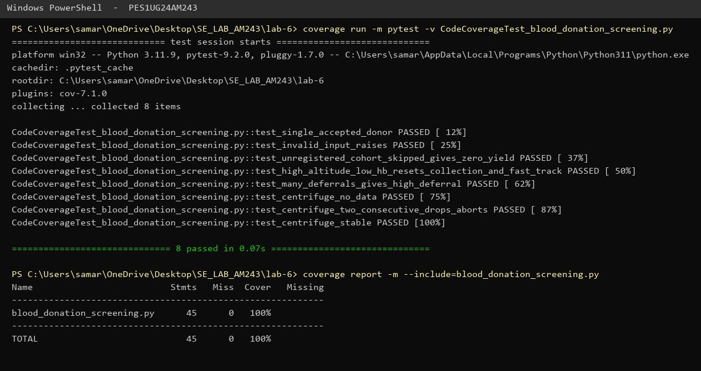
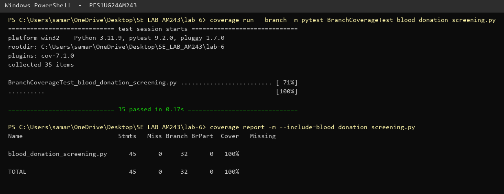

# Lab 6 — Code and Branch Coverage Analysis

**Name:** Samarth A Ambedkar  **SRN:** PES1UG24AM243
**Assigned repo:** [L6_L7_05_blood_donation_screening](https://github.com/SETAPESU26/L6_L7_05_blood_donation_screening)

## Files

| File | Description |
|------|-------------|
| `blood_donation_screening.py` | Module under test (unchanged) |
| `test_blood_donation.py` | Starter test file (given) |
| `CodeCoverageTest_blood_donation_screening.py` | Test cases for code (line) coverage |
| `BranchCoverageTest_blood_donation_screening.py` | Test cases for branch coverage |
| `screenshots/code_coverage.png` | Terminal output, code coverage |
| `screenshots/branch_coverage.png` | Terminal output, branch coverage |

## Commands

```
pip install coverage pytest
coverage run -m pytest CodeCoverageTest_blood_donation_screening.py
coverage report -m --include=blood_donation_screening.py
coverage run --branch -m pytest BranchCoverageTest_blood_donation_screening.py
coverage report -m --include=blood_donation_screening.py
```

## 1. Initial coverage (starter test)

The single starter test only exercises the "happy path" (one healthy donor in a
standard cohort):

```
Name                          Stmts   Miss Branch BrPart  Cover   Missing
-------------------------------------------------------------------------
blood_donation_screening.py      45     24     32      8    43%   3, 10, 21-22, 25-28, 30-31, 36, 39, 41, 46-58
```

`verify_storage_centrifuge` is never called, and none of the error, deferral,
high-altitude, fast-track or final-status branches run.

## 2. Code (line) coverage — 43% → 100%

`CodeCoverageTest_blood_donation_screening.py` adds 8 tests, each aimed at the
missing lines: invalid input (line 3), unregistered cohort and ZERO_YIELD
(10, 41), high-altitude low haemoglobin reset and fast-track bonus (25-28, 36),
age/weight/high-Hb deferrals and HIGH_DEFERRAL (21-22, 30-31, 39), and the
three centrifuge outcomes (46-58).



Result: **45/45 statements, 100% line coverage.**

Running the same file with `--branch` still shows a gap:

```
blood_donation_screening.py      45      0     32      1    99%   26->15
```

Every line ran, but the branch `26 -> 15` (low haemoglobin in a cohort that is
**not** `high_altitude`, so the loop just moves on to the next donor) was never
taken. This is exactly the handout's point: 100% line coverage does not mean
every decision outcome was tested.

## 3. Branch coverage — 100%

`BranchCoverageTest_blood_donation_screening.py` has 35 tests (using
`pytest.mark.parametrize`) that drive every decision both ways and test the
boundary values:

| Decision | True case | False case / boundary |
|---|---|---|
| L2 input check | non-list, volume 0 / negative | valid list |
| L8 cohort loop | cohorts present | empty list |
| L9 `clinic_registered` | registered | `False`, key missing |
| L20 age/weight | age 16, weight 49 | age 17, weight 50 (accepted) |
| L24 Hb < 12.5 | Hb 12.0 / 11.0 | Hb 12.5 (accepted) |
| L26 `high_altitude` | reset + break | standard cohort continues (**26->15**) |
| L29 Hb > 18.0 | Hb 18.1 | Hb 18.0 (accepted) |
| L35 `fast_track` | +50 ml | no bonus |
| L38 deferrals > 4 | 5 deferrals | exactly 4 |
| L40 total == 0 | ZERO_YIELD | ACCEPTED |
| L46 no runs | `[]`, `None` | runs present |
| L51/L52 rpm < 3000 | drop | normal reading, empty run |
| L54 streak >= 2 | two drops in a row | single drop, streak reset between runs |



Result: **45/45 statements, 32/32 branches, 100% branch coverage.**

## 4. Observations

- Line coverage reached 100% with only 8 tests, but branch analysis still found
  an untested path (`26->15`). Branch coverage is the stricter metric.
- Behaviour found while testing: a `high_altitude` cohort with one low-Hb donor
  resets `total_collected_ml` to 0 for **all** cohorts processed so far, not only
  its own, and the fast-track bonus is still added after the reset
  (`test_high_altitude_reset_wipes_previous_cohorts_too`,
  `test_fast_track_after_high_altitude_reset`). The tests record the current
  behaviour; whether it is intended is a question for the spec.
- The centrifuge drop streak resets for each run, so drops at the end of one run
  and the start of the next do not abort.
